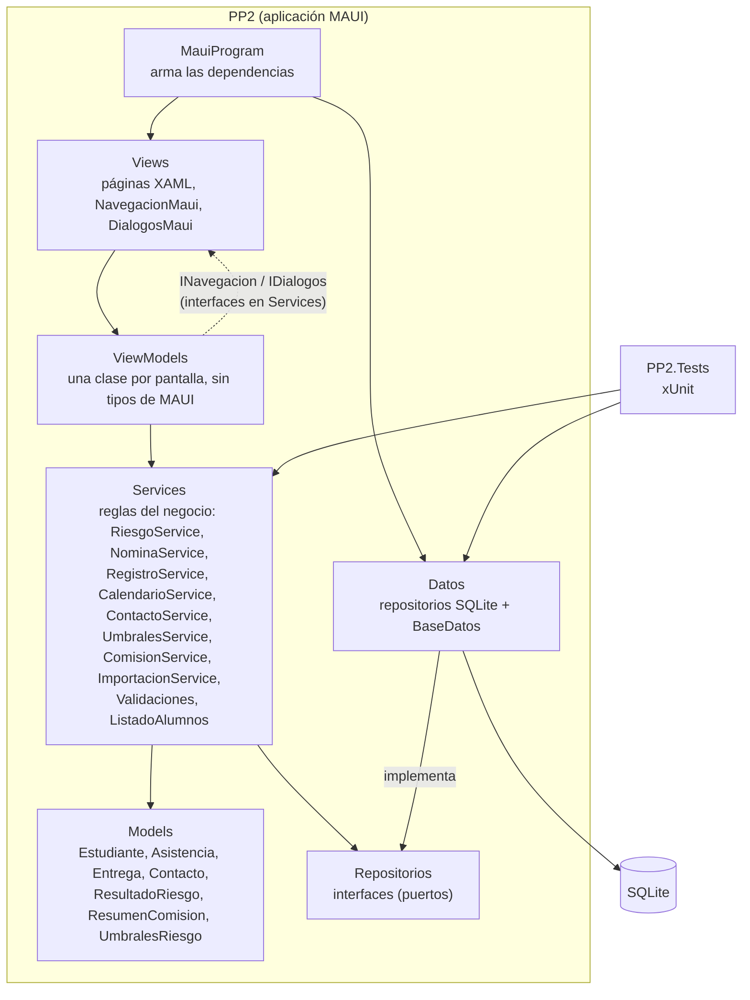

# Arquitectura

Descripción del sistema **tal como está construido hoy**. Lo usa una sola persona (quien sigue una o más comisiones), sin conexión de red: todo se guarda en un archivo SQLite local.

## Componentes

El sistema es un único proyecto MAUI (`PP2/`) organizado en carpetas, más un proyecto de pruebas (`PP2.Tests/`) que referencia a `PP2`. Las capas son carpetas, no proyectos separados (ver [ADR-005](decisiones/ADR-005-capas-y-direccion-de-dependencias.md)).

Cómo leer las flechas:

- **Las dependencias apuntan hacia el dominio** (`Models`, `Services` y las interfaces de `Repositorios`). Los servicios no conocen SQLite ni MAUI: reciben las interfaces por constructor.
- **`Datos` depende del dominio, no al revés.** Cambiar de SQLite a otra base toca solo `Datos/` y `MauiProgram`.
- **Los ViewModels no tocan pantallas.** Para navegar o confirmar algo usan `INavegacion` e `IDialogos`, interfaces definidas en `Services` e implementadas en `Views` (`NavegacionMaui`, `DialogosMaui`). Por eso se pueden probar sin abrir una ventana.
- **`MauiProgram` es el único lugar que conoce todas las piezas** y las conecta.

### Qué hay en cada componente

| Componente | Responsabilidad | Ejemplo |
|---|---|---|
| Views | Mostrar. Código mínimo; abrir pantallas y diálogos reales | `ListaAlumnosPage`, `DialogosMaui` (incluye elegir el archivo CSV) |
| ViewModels | Estado de cada pantalla y sus comandos | `ReporteRiesgoViewModel` muestra el `ResumenComision` que le da el servicio |
| Services | Reglas del negocio y validaciones | `RiesgoService` calcula el riesgo **una sola vez**; lista, ficha y reporte lo reutilizan |
| Models | Datos del dominio | `Estudiante` (con fecha de incorporación), `ResultadoRiesgo` |
| Repositorios | Contrato para guardar y leer, y para agrupar operaciones en una sola | `IEstudianteRepositorio`, `IUnidadDeTrabajo` |
| Datos | Implementación SQLite | `EstudianteRepositorioSqlite`, `BaseDatos` (crea las tablas) |

### Un recorrido de punta a punta

*Importar alumnos desde un CSV y ver el reporte de riesgo:*

1. `ListaAlumnosPage` → botón "Importar alumnos desde CSV" → `ListaAlumnosViewModel.ImportarAlumnosCommand`.
2. El ViewModel pide el archivo con `IDialogos.ElegirArchivoDeTextoAsync` y le pasa el texto a `ImportacionService`.
3. `ImportacionService` (con `LectorCsv`) separa las filas y, por cada una, usa `NominaService`, `CalendarioService` y `RegistroService`: las mismas validaciones que las pantallas.
4. Esos servicios guardan por las interfaces de `Repositorios`; `Datos` las implementa sobre SQLite.
5. `ReporteRiesgoViewModel` pide `RiesgoService.ObtenerResumen(comisión)`, que sale de los mismos resultados que muestra la lista: el número del reporte y el del panel coinciden por construcción.

### Pruebas

- **Unitarias y de aceptación** (`PruebasPP2.cs`): servicios y ViewModels con repositorios en memoria (`RepositoriosEnMemoria.cs`). No necesitan base ni pantallas.
- **De integración** (`PruebasIntegracionSqlite.cs`): los servicios reales sobre repositorios SQLite: importar el CSV de ejemplo (`datos-ejemplo/alumnos-demo.csv`, 200 alumnos) con sus reportes de riesgo, y que lo guardado se lea igual al reabrir la base.
